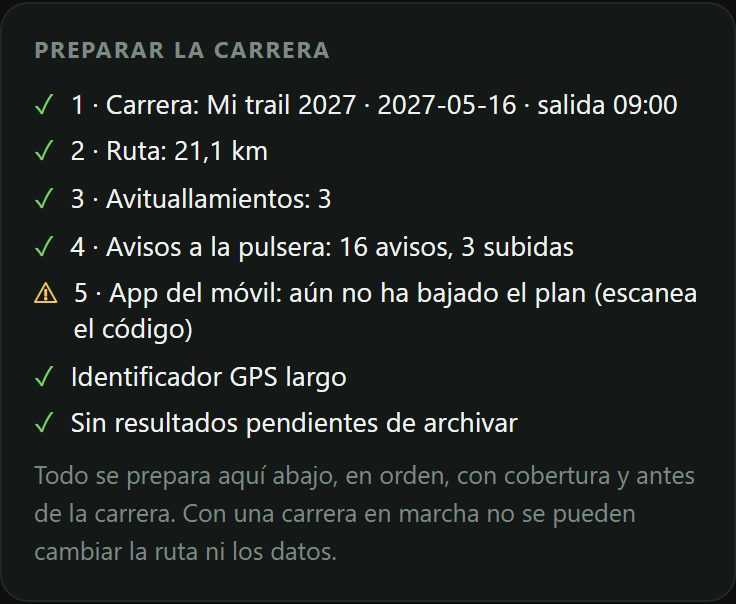

# Preparar una carrera, paso a paso

Guía para dejar lista una carrera nueva. El panel enseña en todo momento qué
está listo y qué falta:

<p align="center"></p>

```
 ┌────────────┐   ┌──────────────┐   ┌──────────────┐   ┌───────────┐   ┌──────────┐
 │ 1. GPX     │ → │ 2. carrera   │ → │ 3. plan de   │ → │ 4. panel  │ → │ 5. día de│
 │ → ruta     │   │   .json      │   │    avisos    │   │  y móvil  │   │  carrera │
 └────────────┘   └──────────────┘   └──────────────┘   └───────────┘   └──────────┘
                                                                              ↓
                                         ┌──────────────┐   ┌──────────────────────┐
                                         │ 7. archivar  │ ← │ 6. resultado (FIT)   │
                                         └──────────────┘   └──────────────────────┘
```

---

## 1 · La ruta, desde el GPX

```bash
python herramientas/preparar_ruta.py ruta.gpx --nombre "Mi carrera" --distancia 21.1
```

| Sale | Para qué |
|---|---|
| `route.geojson` | el trazado del mapa |
| `elevation.json` | el perfil y las pendientes |

`--distancia` = km **oficiales** si no coinciden con los que mide el GPX. Al
terminar te dice qué poner en `carrera.json` (distancia y desnivel).

✅ En el panel: **Ruta: 21,1 km**

## 2 · Los datos de la carrera

`carrera.json` (todos los campos, en la tabla del README):

```json
{
  "nombre": "Mi trail 2026", "lugar": "Mi pueblo", "fecha": "2026-11-22",
  "hora_salida": "09:00", "modalidad": "Trail", "distancia_km": 21.1, "desnivel_m": 850,
  "limite_h": 5, "km_minimos_meta": 17, "slug": "2026-mi-trail",
  "corredor": {"nombre": "Odegaard12", "dorsal": "27"}
}
```

`aid_stations.json` (avituallamientos):

```json
[{"name": "Avituallamiento 1", "km": 7.5}, {"name": "Meta", "km": 21.1, "principal": true}]
```

✅ En el panel: **Carrera** y **Avituallamientos**

## 3 · El plan de avisos para la pulsera

```bash
python herramientas/plan_avisos.py
```

Lee el perfil y escribe `avisos.json`: **en el km X → este texto**. Te enseña
las subidas y los avisos para revisarlos en casa (si alguno no te gusta,
cambia su texto en `avisos.json`):

```
SUBIDAS
   1. km   4.20–  5.60    1,4km  + 112 m   8.0%  máx 19%  larga
   2. km   9.10–  9.50     400m  +  58 m  14.5%  máx 22%  corta_dura
AVISOS
  km   3.90  SUBIDA LARGA · 1,4km · 8% · +112m · rampa 19%
  km   7.20  AVITUALLAMIENTO en 300m · Avituallamiento 1
  km   8.80  CORTA DURA · 400m · 15% · +58m · rampa 22%
  km   9.50  CIMA · bajada 1,2km · -90m · quedan +310m
  km  20.10  ÚLTIMO KM · ¡a por ello!
```

| Aviso | Cuándo |
|---|---|
| SUBIDA / SUBIDA LARGA / CORTA DURA / RAMPA | 300 m antes de cada subida (tipo, largo, %, D+, rampa) |
| MITAD | a mitad de las subidas de más de 1,5 km |
| CIMA | arriba: cómo es la bajada y el D+ que queda |
| AVITUALLAMIENTO | 300 m antes (la distancia se calcula al enviarlo) |
| KM X | resumen cada 3 km (5 o 10 en carreras largas) |
| ÚLTIMA SUBIDA · ÚLTIMO KM | al final |

Repechos de menos de 30 m y falsos llanos (< 3 %) no avisan. Dos avisos a
menos de 400 m se juntan.

✅ En el panel: **Plan de avisos: N avisos**

## 4 · Panel y móvil (la víspera)

1. **Avisos a la pulsera:** en la configuración del servicio,
   `SIGUEME_NTFY=https://tu-ntfy/tema` (y `SIGUEME_NTFY_TOKEN` si hace falta).
   En el móvil, la app **ntfy** suscrita a ese tema y, en Mi Fitness,
   notificaciones de ntfy activadas. Pulsa **Enviar aviso de prueba** con una
   actividad en marcha en la pulsera: tiene que vibrar y verse el texto.
2. **Generar identificador nuevo** en el panel y ponlo en Traccar (y en el reloj
   si lo usas).
3. Si usas iGPSPORT, pega su enlace de seguimiento en el panel.

✅ En el panel: todo en verde

## 5 · El día de la carrera

1. Panel → revisa la hora de salida → **Guardar y empezar a seguir**.
2. Traccar (y/o la miniapp del reloj) en marcha antes de salir. En el panel,
   «GPS del móvil: ahora mismo».
3. Comparte el enlace con el botón de la web.
4. Los avisos llegan solos. **Por estado:** si te quedas sin cobertura, al
   volver no llegan los avisos atrasados, llega uno con lo de ahora
   («EN SUBIDA · quedan 600m · +60m»).
5. La llegada se detecta sola (si el directo se cortó, pon la hora en el panel
   y **Finalizar seguimiento**).

## 6 · El resultado

```bash
python herramientas/generar_resultado.py actividad.fit
```

La web pasa a modo resultado: tiempo, paso por avituallamientos, repetición.

## 7 · Archivar

Panel → **Archivar la carrera terminada**. Queda en `/2026-mi-trail/`, sale en
`/carreras/` y la portada queda a cero para la siguiente.
