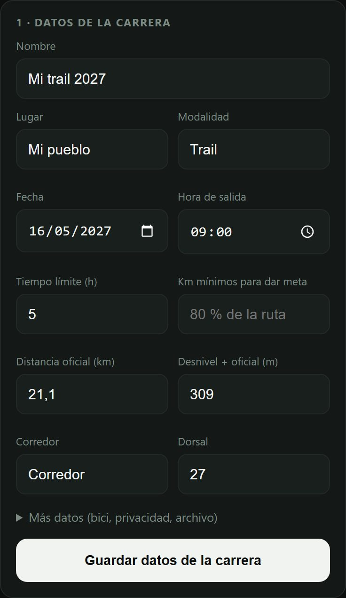
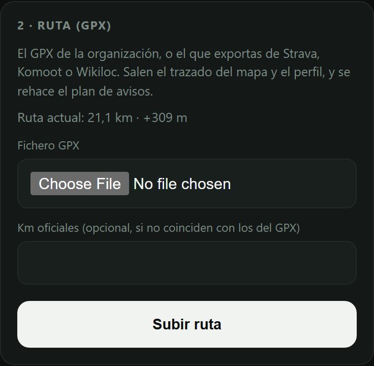
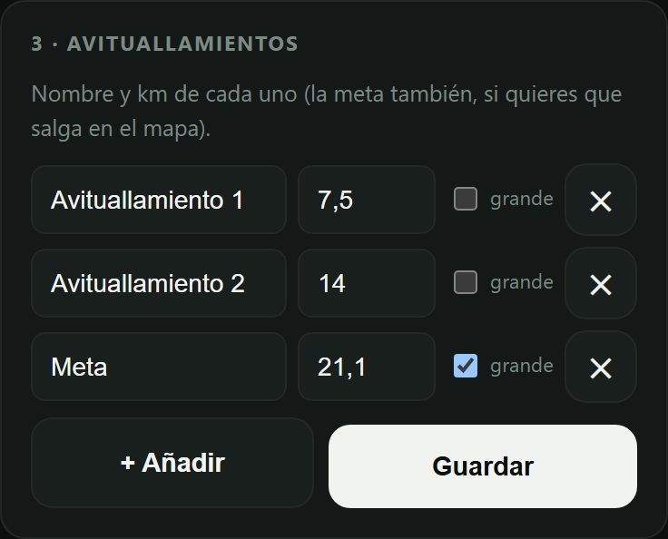
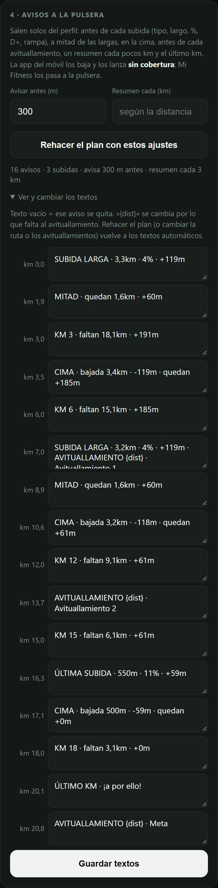

# Preparar una carrera, paso a paso

Todo se hace desde el **panel** (`/admin.html`), con cobertura y antes de la
carrera. Arriba, la lista «Preparar la carrera» enseña en todo momento qué está
listo y qué falta:

<p align="center"></p>

```
 ┌────────────┐   ┌──────────┐   ┌──────────────┐   ┌───────────┐   ┌──────────────┐
 │ 1. datos   │ → │ 2. GPX   │ → │ 3. avitualla-│ → │ 4. avisos │ → │ 5. app del   │
 │  carrera   │   │  → ruta  │   │    mientos   │   │ (revisar) │   │ móvil (QR)   │
 └────────────┘   └──────────┘   └──────────────┘   └───────────┘   └──────────────┘
                                                                           ↓
          ┌──────────────┐   ┌──────────────────────┐   ┌────────────────────────┐
          │ 8. archivar  │ ← │ 7. resultado (FIT)   │ ← │ 6. día de la carrera   │
          └──────────────┘   └──────────────────────┘   └────────────────────────┘
```

> Con una carrera en marcha el panel no deja cambiar la ruta, los datos ni los
> avituallamientos: así un toque sin querer no la rompe a mitad.

---

## 1 · Datos de la carrera

Nombre, lugar, fecha, hora de salida, tiempo límite, corredor y dorsal. En
«Más datos»: la bici para la ficha, los metros alrededor de salida y meta en
los que no se publica tu posición (si salen de tu casa), la zona horaria y la
dirección que tendrá al archivarla.

<p align="center"></p>

## 2 · La ruta, desde el GPX

El GPX de la organización o el que exportas de Strava, Komoot o Wikiloc. Si la
organización da otra distancia oficial, ponla en «Km oficiales»: la web escala
los km para que la meta caiga ahí.

<p align="center"></p>

Salen el trazado del mapa y el perfil; la distancia y el desnivel pasan a los
datos de la carrera (si el desnivel oficial es otro, cámbialo en el paso 1).
Hasta 20 MB.

## 3 · Avituallamientos

Nombre y km de cada uno. «grande» lo marca como principal en el mapa.

<p align="center"></p>

## 4 · Los avisos para la pulsera

Se calculan solos del perfil al subir la ruta (y se rehacen al cambiar los
avituallamientos o el desnivel). Revísalos en casa:

<p align="center"></p>

| Aviso | Cuándo |
|---|---|
| SUBIDA / SUBIDA LARGA / CORTA DURA / RAMPA | antes de cada subida (tipo, largo, %, D+, rampa) |
| MITAD | a mitad de las subidas de más de 1,5 km |
| CIMA | arriba: cómo es la bajada y el D+ que queda |
| AVITUALLAMIENTO | antes de cada uno (lo que falta se calcula al avisar) |
| KM X | resumen cada 3 km (5 o 10 en carreras largas) |
| ÚLTIMA SUBIDA · ÚLTIMO KM | al final |

- **Avisar antes** (300 m) y **Resumen cada** se cambian arriba y se pulsa
  «Rehacer el plan».
- Los textos se cambian a mano; un texto vacío quita ese aviso.
- Repechos de menos de 30 m y falsos llanos (< 3 %) no avisan; dos avisos a
  menos de 400 m se juntan en uno.

Los avisos **no dependen de la cobertura**: los lanza el móvil, que los tiene
guardados (paso 5).

## 5 · La app del móvil

*(La app Android llega en la siguiente versión.)* En casa, abre la app y
escanea el código QR del panel: baja la ruta, el perfil y los avisos. En
carrera, con la pantalla apagada y sin cobertura:

- sigue tu km con el GPS del propio móvil y lanza cada aviso como notificación;
  **Mi Fitness** (o la app de tu reloj) la pasa a la pulsera;
- guarda tu posición y la manda a la web en cuanto vuelve la cobertura.

Si cambias algo en el panel después, pulsa «Actualizar plan» en la app. Si
generas un identificador nuevo, vuelve a escanear el código.

Mientras no tengas la app, la posición se puede mandar con **Traccar Client**
(Android e iPhone) o el reloj Amazfit: en el README, «Elegir cómo se manda tu
posición».

## 6 · El día de la carrera

1. Panel → revisa la hora de salida → **Guardar y empezar a seguir**.
2. La app (o Traccar, o la miniapp del reloj) en marcha antes de salir. En el
   panel, «GPS del móvil: ahora mismo».
3. Comparte el enlace con el botón de la web.
4. **Sin cobertura**, la web lo dice («Sin cobertura desde las 12:03, km 44»)
   y una marca transparente avanza por la ruta a tu ritmo medio. También
   enseña la hora prevista al próximo avituallamiento y a meta. Al volver la
   cobertura llegan los puntos guardados y manda otra vez tu posición real.
5. La llegada se detecta sola (si el directo se cortó, pon la hora en el panel
   y **Finalizar seguimiento**).

## 7 · El resultado

```bash
python herramientas/generar_resultado.py actividad.fit
```

La web pasa a modo resultado: tiempo, paso por avituallamientos, repetición.

## 8 · Archivar

Panel → **Archivar la carrera terminada**. Queda en `/2027-mi-trail/`, sale en
`/carreras/` y la portada queda a cero para la siguiente.

---

**Sin panel**, desde la consola, hacen lo mismo:
`python herramientas/preparar_ruta.py ruta.gpx --distancia 21.1` (paso 2) y
`python herramientas/plan_avisos.py [--antes 0.3] [--cada 3]` (paso 4).
